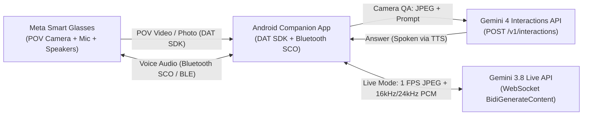

# Gemini Vision for Meta Smart Glasses (Audio + Camera, No Display)

An Android companion app built with **Kotlin**, **Jetpack Compose**, and the **Meta Wearables Device Access Toolkit (DAT) SDK (`mwdat-core` & `mwdat-camera`)** that connects **Ray-Ban Meta / Oakley Meta smart glasses** (non-display models) to Google's **Gemini 4 Interactions API** and **Gemini 3.8 Live API**.

---

## How It Works

Because Ray-Ban Meta / Oakley Meta glasses have a **POV camera, microphones, and open-ear speakers** (no HUD screen), your Android phone acts as the companion brain relaying audio and video between your glasses and Gemini:



### 1. Glasses ↔ Phone Link
- **Camera feed (`Meta Wearables DAT SDK`)**: On launch, `GeminiVisionApp` initializes `Wearables`. `MetaGlassesManager` links with the Meta AI app (`startRegistration`), requests `Permission.CAMERA`, opens a `DeviceSession`, attaches the glasses camera (`session.addCamera`), and streams raw POV video frames (`VideoFrame`) plus sharp still photos (`capturePhoto()`).
- **Frame encoding (`FrameCodec`)**: Converts the glasses' raw YUV/I420 video frames (or HEIC photos) into compact downscaled JPEGs (max 768px) for fast mobile uploads and live phone preview.
- **Bluetooth audio routing (`LiveAudioEngine`)**: Uses Android `AudioManager` in `MODE_IN_COMMUNICATION` to route audio through your paired Meta glasses (`TYPE_BLUETOOTH_SCO` / `TYPE_BLE_HEADSET`) so your voice comes from the glasses mic and Gemini responds directly into your glasses speakers.

### 2. Mode 1 — Camera QA (Turn-by-Turn Vision Queries)
1. Ask via voice (`VoiceAssistHelper`), text, or one-tap quick chips (e.g. *"What am I looking at?"*, *"Read this text aloud"*).
2. The app captures a crisp photo from your glasses camera (`capturePhotoOrLatestFrame()`).
3. `GeminiQaClient` sends the base64 JPEG + prompt to **`POST /v1/interactions`** (default model: **`gemini-4-hydrogen`**), chaining `previous_interaction_id` for stateful multi-turn follow-up questions.
4. Gemini's reply appears in the companion chat log and is **automatically spoken aloud** into your glasses speakers via Android Text-to-Speech.

### 3. Mode 2 — Gemini Live (Hands-Free Real-Time Call)
1. Tapping **Start Live** opens a persistent WebSocket (`BidiGenerateContent`) to **`gemini-3.8-live`** via `GeminiLiveClient`.
2. **Outgoing**: `LiveAudioEngine` streams 16 kHz mono PCM from your glasses mic (`realtimeInput.audio`, with hardware echo cancellation and `audioStreamEnd` on mute) while sending the latest glasses JPEG frame every second (`1 FPS`, `realtimeInput.video`).
3. **Incoming**: Gemini streams back 24 kHz native voice audio directly into your glasses speakers with instant **barge-in** interruption handling (`serverContent.interrupted` flushes the audio buffer immediately) plus live scrolling captions on your phone screen.

---

## First-Time Setup on Your Phone

1. **Enable Developer Mode in the Meta AI app** on your Android phone (Settings → App Info → enable Developer Mode). This allows local development builds using the default `mwdat_application_id = "0"` and `mwdat_client_token = "0"`. For production distribution, set `MWDAT_APPLICATION_ID` and `MWDAT_CLIENT_TOKEN` in `local.properties` from the Meta Wearables Developer Center.
2. **Install the APK**:
   - Download `gemini-vision-meta-glasses-v1.0.0-debug.apk` from the [Releases](https://github.com/mattalter2024/gemini-vision-meta-glasses/releases) page, **or** build from source below.
3. **Add your Gemini API key** from [Google AI Studio](https://aistudio.google.com/):
   - Open **Gemini Vision** → tap the **Settings** gear → paste your API key → Save (or set `GEMINI_API_KEY=your_key_here` in `local.properties` before building).
4. **Connect & Go**:
   - Tap **Connect Meta Glasses** → approve in Meta AI → **Allow Glasses Camera** → **Start Glasses Camera**.
   - Don't have glasses handy? Tap **Test with Phone Camera Instead** (or switch Video Source in Settings) to test with your phone camera right away.

---

## Build & Test from Source

```powershell
# Run unit tests and build the debug APK
.\gradlew.bat testDebugUnitTest assembleDebug

# Install onto a connected Android phone
adb install -r app\build\outputs\apk\debug\app-debug.apk
```
